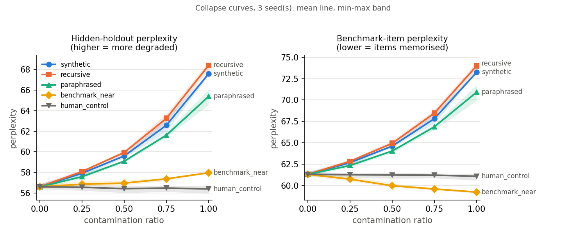

# ORIGIN-T weekly update: week ending Mon 2026-11-02 (CP0)

Template: [PROJECT_REPORT.md §7](../PROJECT_REPORT.md#hod-reporting). Compiled by Vishnu from
the merged PRs and the issue tracker (HANDBOOK §15). Every number links to the PR or file it
comes from. **Hours and learning lines are each student's to fill in.**

## Gate status

| Gate | Verdict | Evidence |
|---|---|---|
| GATE 0: recursive self-training collapses | **Passed** (3/3 seeds) | [#8](https://github.com/SheeshDarth/OriginX-T/pull/8) |
| GATE 1: features + static baseline on ≥ 2 datasets | **Not evaluable** (WikiText only) | [#94](https://github.com/SheeshDarth/OriginX-T/pull/94), [#105](https://github.com/SheeshDarth/OriginX-T/pull/105) |
| GATE 2: dose-response above seed noise | **Passed** | [#12](https://github.com/SheeshDarth/OriginX-T/pull/12), [#73](https://github.com/SheeshDarth/OriginX-T/pull/73) |
| GATE 3: early warning across contamination ratios | **Failed, exploratory**: collapse already shows at the first ratio, so there is no stage to warn from | [#73](https://github.com/SheeshDarth/OriginX-T/pull/73) |
| X1 / X2 / X3 | Not started / not started / built, verdict after CP0 | [#110](https://github.com/SheeshDarth/OriginX-T/pull/110) |

## Key result

Hidden-holdout perplexity rises with the share of model-generated training data (56.6 clean →
67.6 synthetic, 68.4 recursive, 65.4 paraphrased at 100%), while a healthy arm of fresh human
text stays flat (56.4). Benchmark leakage shows as memorisation instead (benchmark-item
perplexity −3.4%).

## Metrics vs. target (PRD §7)

| Area | Target | This week | |
|---|---|---|---|
| Contamination detection | AUROC ≥ 0.80 | Per-sample reference-LM score 0.78 pooled; 0.88-0.98 on generated types, 0.97 for near-copies with the kNN score ([#92](https://github.com/SheeshDarth/OriginX-T/pull/92)) | partly |
| Collapse prediction | correlation ≥ 0.60 | Risk model leave-one-type-out AUROC 0.84 [0.72, 0.94]; correlation not computed yet; ties the single best feature ([#105](https://github.com/SheeshDarth/OriginX-T/pull/105)) | open |
| Calibration | conformal coverage 0.90 | 0.72: under-covers ([#105](https://github.com/SheeshDarth/OriginX-T/pull/105)) | not met |
| Early warning | lead time > 0 at fixed FA | Fails on the ratio axis (GATE 3); X3 measures it over training steps after CP0 | open |
| Mitigation | ≥ 10-20% relative recovery | Not started (X1) | — |
| Benchmark leakage | ≥ 1 demonstrated case | Shown: training on near-copies lowers benchmark perplexity 3.4% | **met** |
| Reproducibility | config + seed for every run | Pinned lock file; the 24 logged runs that are grid cells reproduce the grid's perplexity exactly | **met** |

## Planned vs. done, per student

**Vishnu (Track C: infra, experiments, API, X2, X3).**
- Planned for CP0: lock file (C1), trainlog fixture (C2). **Done**, plus CP1/CP2 items ahead of plan.
- Done: healthy control arm and the WikiText control run (GATE 3 now evaluable); FastAPI with
  audit jobs and a live run stream; reference-LM and semantic feature families and WikiText
  features for all 75 cells; per-sample risk scores; X3 live logger, two-sided conformal
  alarm and its 67 logged runs; Live monitor screen; second literature search (changed three
  novelty claims). PRs [#68](https://github.com/SheeshDarth/OriginX-T/pull/68)-[#75](https://github.com/SheeshDarth/OriginX-T/pull/75), [#88](https://github.com/SheeshDarth/OriginX-T/pull/88)-[#93](https://github.com/SheeshDarth/OriginX-T/pull/93), [#98](https://github.com/SheeshDarth/OriginX-T/pull/98), [#103](https://github.com/SheeshDarth/OriginX-T/pull/103), [#110](https://github.com/SheeshDarth/OriginX-T/pull/110)-[#112](https://github.com/SheeshDarth/OriginX-T/pull/112).
- Hours logged: _to fill_ (≤ 7)
- Learning line: _concept + evidence link + one open question, to fill_

**Revanth (Track A: modeling and the console UI).**
- Planned for CP0: features/risk fixtures (A1). **Done**, plus A2-A10 and A12's e2e.
- Done: lexical and leak feature families, the feature-suite CLI, the risk classifier
  (cross-checked against scikit-learn and XGBoost), split conformal, baselines and the GATE 1
  verdict, the audit CLI; console shell, Overview, collapse curves, cell detail, Audit and
  Repair screens; Playwright e2e with axe; Track A paper section. PRs [#76](https://github.com/SheeshDarth/OriginX-T/pull/76)-[#87](https://github.com/SheeshDarth/OriginX-T/pull/87), [#94](https://github.com/SheeshDarth/OriginX-T/pull/94)-[#101](https://github.com/SheeshDarth/OriginX-T/pull/101), [#104](https://github.com/SheeshDarth/OriginX-T/pull/104)-[#109](https://github.com/SheeshDarth/OriginX-T/pull/109).
- Hours logged: _to fill_ (≤ 7)
- Learning line: _to fill_

**Siddharth (Track B: data, bench, X1).**
- Planned for CP0: harm/repair fixtures (B1), GPU booking calendar (B2). **B1 done**, B2 open.
- Done: B1 fixtures, the `duplicate` contamination generator (B4). PRs [#106](https://github.com/SheeshDarth/OriginX-T/pull/106), [#107](https://github.com/SheeshDarth/OriginX-T/pull/107).
- Not started: TinyStories prep (B3, #58), which is on the critical path for CP1.
- Hours logged: _to fill_ (≤ 7)
- Learning line: _to fill_

## Blockers

1. **TinyStories prep (#58, Siddharth)** blocks the second grid, GATE 1, the confirmatory
   GATE 3 and the TinyStories features. It is the team's critical path to CP1 (2026-11-20).
2. **CP0 decisions (#21)**: the X3 rule (`configs/x3.yaml`), the confirmatory GATE 3 rule, the
   label D4, and the three novelty claims the literature search changed.
3. **X2** needs a target model trained on Siddharth's GPU (B11).

## Next week

- CP0 meeting (Tue 2026-11-03): confirm the rules above, then compute the X3 verdict.
- TinyStories normalization and leak check (#58), then its grid (#29) and features.
- X1 pilot: per-sample harm scores (#62) against the `risk_reflm` baseline.
- Risk model: address the under-coverage and the tie with the single-feature baseline.
